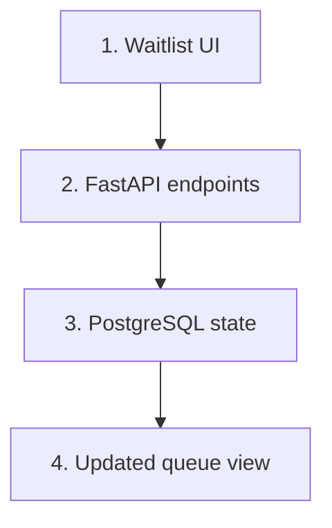

<div align="center">

# Restaurant Waitlist Manager

**Operational waitlist product**

Full-stack waitlist management for restaurants — FastAPI backend, React frontend, and Docker delivery.

[](https://www.typescriptlang.org/)
[](https://fastapi.tiangolo.com/)
[](https://react.dev/)
[](https://mounir-gmamsi.netlify.app/)

</div>

---

## Overview

Restaurant Waitlist Manager helps restaurants manage guest queues digitally. The system follows an OpenAPI contract, with a FastAPI backend, PostgreSQL persistence, and a TypeScript React client for day-to-day waitlist operations.

---

## What the product delivers

| Capability | Description |
|------------|-------------|
| Waitlist operations | Add, update and track waiting guests |
| API contract | OpenAPI-driven backend implementation |
| Staff UI | React application for operational use |
| Persistence | Relational storage for waitlist state |
| Local delivery | Docker Compose end-to-end stack |
| Quality | Backend and frontend tests |

---

## Technology stack

### Backend


### Frontend


### Platform


| Layer | Technologies |
|-------|----------------|
| API | FastAPI, SQLAlchemy, PostgreSQL, Uvicorn |
| UI | React, TypeScript, Vite |
| Contract | OpenAPI (`openapi.yaml`) |
| Ops | Docker Compose, Makefile |

---

## Solution flow

| Step | Stage | Technologies |
|:----:|-------|--------------|
| 1 | Staff updates waitlist in UI | React, TypeScript |
| 2 | API validates against contract | FastAPI, OpenAPI |
| 3 | Persist queue state | SQLAlchemy, PostgreSQL |
| 4 | Refresh UI status | REST JSON |
| 5 | Run stack locally | Docker Compose |



---

## Repository structure

| Path | Purpose |
|------|---------|
| `backend/` | FastAPI service (uv / pyproject) |
| `frontend/` | React + Vite client |
| `openapi.yaml` | API contract |
| `docker-compose.yml` | Local stack |
| `e2e/` | End-to-end tests |

---

## Run locally

```bash
docker compose up --build
```

See `Makefile` and backend/frontend READMEs for development workflows.

---

## Author

**Mounir Gmamsi**  
[Portfolio](https://mounir-gmamsi.netlify.app/) · [GitHub](https://github.com/Mr-Gms-33) · [LinkedIn](https://www.linkedin.com/in/mounir-gmamsi-1595951b3)
